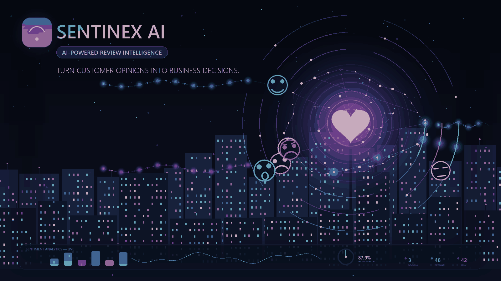
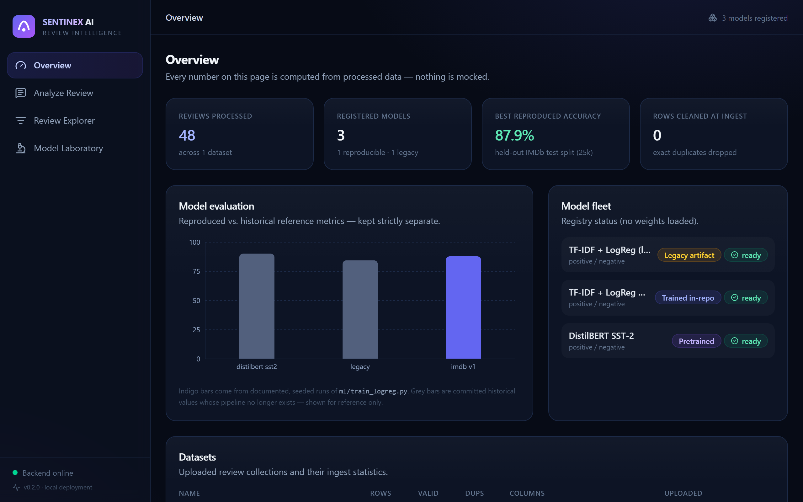
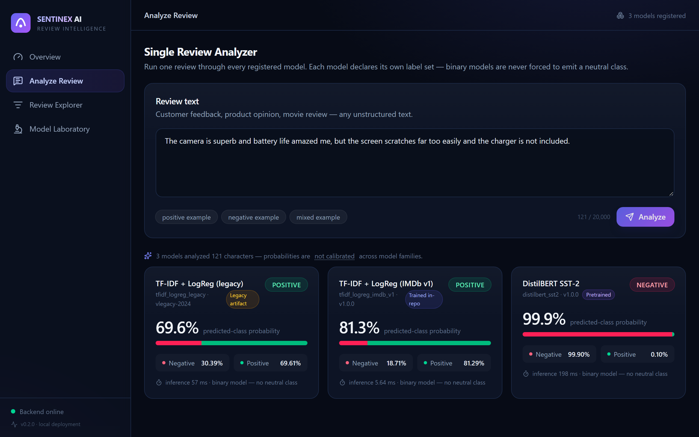
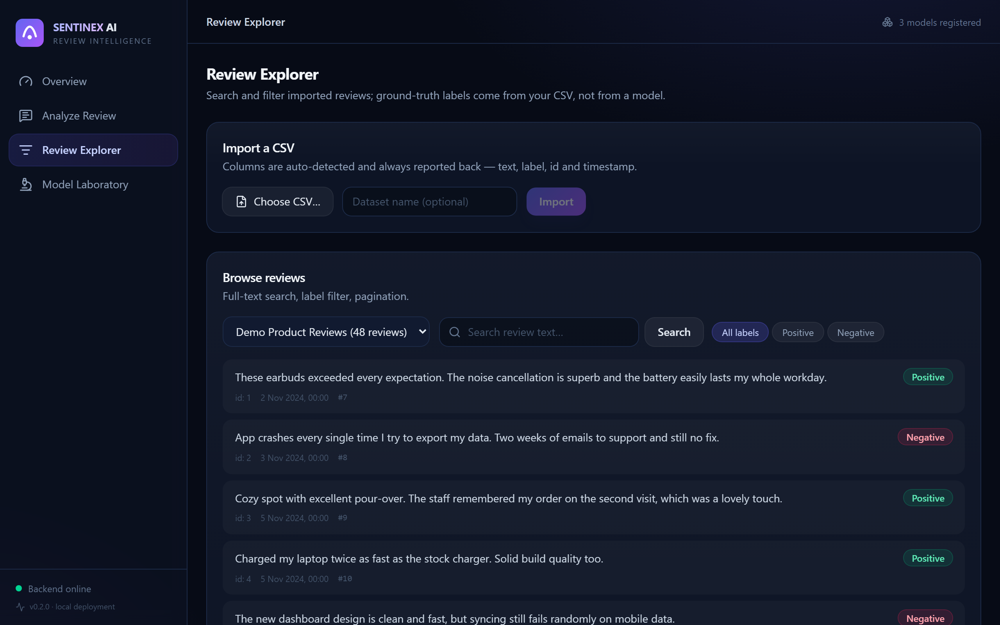
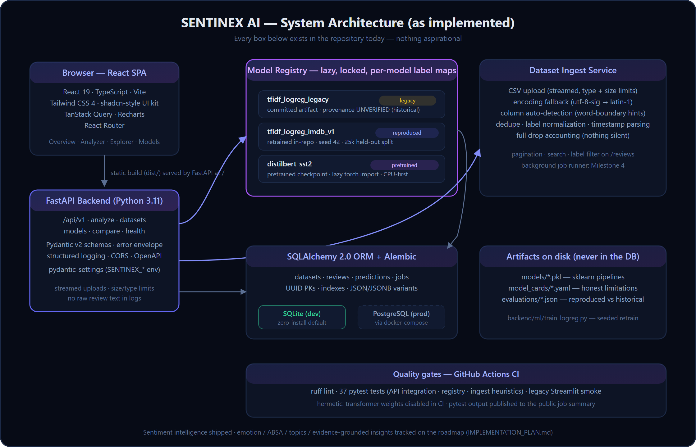
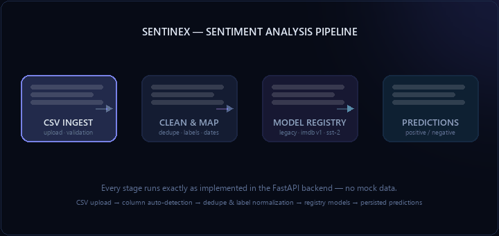
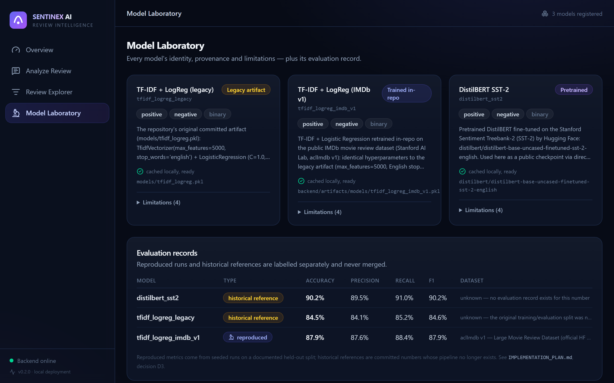
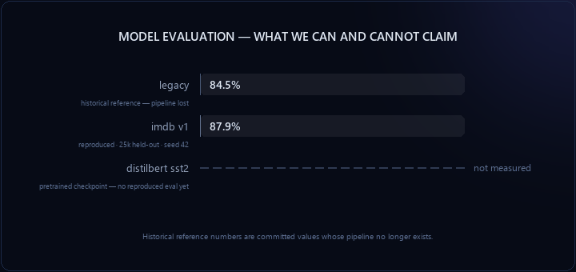
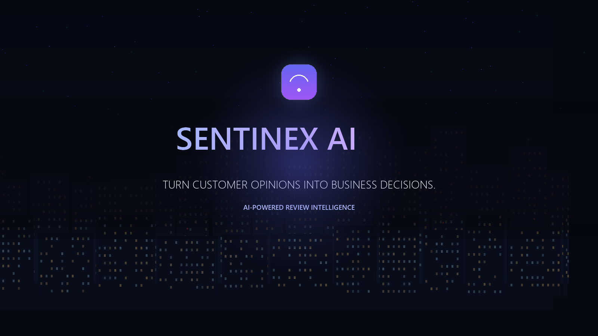

<div align="center">



# SENTINEX AI

### Turn Customer Opinions Into Business Decisions.

**Sentiment Intelligence · Model Comparison · Evidence-First Analytics**

[](https://github.com/Avani376/sentiment-analysis-github/actions/workflows/ci.yml)


[Features](#-features) · [Architecture](#-architecture) · [Model Evaluation](#-model-evaluation) · [Quick Start](#-quick-start) · [API](#-api-documentation) · [Deployment](#-deployment)

</div>

---

> **Live demo:** not published yet — the deployment stack (Docker + Render
> blueprint) is prepared and documented in [DEPLOYMENT.md](DEPLOYMENT.md), and
> publishing requires the repository owner's hosting account. Every claim in
> this README is reproducible locally in under two minutes.

## What is SENTINEX?

SENTINEX AI is a **review intelligence platform** that runs customer feedback
through multiple sentiment models side-by-side, shows exactly what each model
thinks and how confident it is, and separates *reproducible evidence* from
*historical claims* — the part most ML demos quietly skip.

It started as a small Streamlit comparison demo and was rebuilt into a
production-shaped system: a FastAPI backend with a model registry, a React
analytics dashboard, database persistence, migrations, CI, and a reproducible
training pipeline. The original Streamlit app is still included and still
works.

<div align="center">

</div>

## Why

- **One model is an opinion.** SENTINEX runs every review through a model
  registry — a legacy TF-IDF pipeline, a retrained TF-IDF pipeline with fully
  documented provenance, and a pretrained DistilBERT — and shows their
  disagreement honestly (see the analyzer screenshot: two models say
  *positive*, one says *negative*).
- **Metrics need provenance.** The repository's original accuracy number
  (84.5%) could not be reproduced by anything in the repo. Instead of hiding
  that, SENTINEX retrains the same architecture on the public IMDb dataset
  with a seeded, documented pipeline and labels every number
  **reproduced** or **historical reference** — and never mixes the two.
- **Confidence is not calibration.** Probability outputs are reported as-is,
  with explicit "not calibrated" disclosures, and binary models are never
  forced to invent a neutral class.

## ✨ Features (all implemented — no mock buttons)

| Area | What works today |
|---|---|
| **Model registry** | 3 registered models with per-model label maps, lazy loading, latency measurement, YAML model cards with honest limitations |
| **Single analysis** | One review → every available model → labels, probability distributions, per-model latency |
| **Dataset management** | CSV upload with encoding fallback, column auto-detection, duplicate/missing/invalid-label accounting, full-text search, filters, pagination |
| **Dashboard** | KPIs computed from stored data; evaluation chart that never mixes reproduced and historical metrics |
| **Model Laboratory** | Provenance badges (trained-in-repo / legacy / pretrained), expandable limitations, evaluation records table |
| **Reproducible training** | `ml/train_logreg.py` — IMDb download with SHA-256 provenance, seed 42, disjoint 25k test split, JSON evaluation artifacts |
| **Engineering** | FastAPI + Pydantic v2, SQLAlchemy 2.0 + Alembic, SQLite dev default / PostgreSQL ready, structured errors, CI (ruff + 37 tests), Docker stack |

<div align="center">
<table>
<tr>
<td width="50%"><sub><b>Single Review Analyzer</b> — three models, real disagreement, full probability distributions.</sub></td>
<td width="50%"><sub><b>Review Explorer</b> — CSV import with auto-detected mapping, search and label filters.</sub></td>
</tr>
</table>
</div>

## 🏗 Architecture

<div align="center">

</div>

The pipeline animation shows the actual ingest → analysis flow as implemented
in the backend (no mock stages):

<div align="center">

</div>

<details>
<summary><b>Design decisions that matter</b></summary>

- **Registry over hardcoding.** Every model implements one protocol
  (`predict_batch`, metadata, model card). Adding a model = one adapter file +
  one YAML card.
- **Lazy, locked loading.** Transformers import torch only when first needed;
  per-model locks prevent double-loads under concurrent requests. CPU-only
  inference is a first-class path.
- **SQLite-first persistence.** Zero-install local dev via SQLAlchemy 2.0;
  the same schema runs on PostgreSQL (see `docker-compose.yml`).
- **Honest error handling.** One error envelope across the API; raw review
  text never reaches logs.
- **Migration, not rewrite.** The original Streamlit app remains runnable
  (`streamlit run app/app.py`) and is smoke-checked in CI.

</details>

## 🔬 Model Evaluation

Second-run determinism is verified: `ml/train_logreg.py` executed twice
produced identical metrics on the held-out split.

| Model | Type | Accuracy | Precision | Recall | F1 | Provenance |
|---|---|---:|---:|---:|---:|---|
| `tfidf_logreg_imdb_v1` | TF-IDF + LogReg | **87.93%** | 87.56% | 88.42% | 87.93% | Reproduced — 25k IMDb test split, seed 42 |
| `tfidf_logreg_legacy` | TF-IDF + LogReg | 84.5% | 84.1% | 85.2% | 84.6% | ⚠️ Historical reference — pipeline lost |
| `distilbert_sst2` | Transformer | — | — | — | — | Pretrained checkpoint, **not fine-tuned here**; no reproduced eval yet |

<div align="center">

</div>

<div align="center">

</div>

<details>
<summary><b>How the reproduced number was produced (and why legacy numbers are quarantined)</b></summary>

- **Data:** aclImdb v1 (Large Movie Review Dataset) via the official
  `stanfordnlp/imdb` conversion — 25,000 train / 25,000 test, SHA-256 of the
  downloaded files recorded in the evaluation artifact.
- **Pipeline:** identical hyperparameters to the legacy artifact
  (`TfidfVectorizer(max_features=5000, english stopwords, unigrams)` →
  `LogisticRegression(C=1.0, lbfgs, max_iter=1000)`), so legacy vs. reproduced
  differs by *provenance, not capacity*.
- **Why the legacy 84.5% stays:** it ships as a clearly-labelled
  `historical_reference` artifact. No chart in the product mixes it with
  reproduced results, and its model card states the training pipeline was
  never versioned.
- **Confusion matrix (reproduced):** `[[10930, 1570], [1447, 11053]]` —
  negative row, then positive.
- **Limitations:** movie-review domain; no calibration applied; unigram
  features; full details live in each model card and in
  `backend/artifacts/evaluations/`.

</details>

## 🚀 Quick Start

```bash
git clone https://github.com/Avani376/sentiment-analysis-github.git
cd sentiment-analysis-github

# — Backend (Python 3.11) —
python -m venv venv && venv\Scripts\activate       # Linux/macOS: source venv/bin/activate
pip install -r backend/requirements.txt
cd backend && alembic upgrade head
python -m uvicorn app.main:app --reload            # → http://localhost:8000
```

Open **http://localhost:8000** for the dashboard (or `/docs` for the OpenAPI
UI). DistilBERT activates on first use and downloads ~270 MB from the Hugging
Face cache; skip it with `SENTINEX_ENABLE_DISTILBERT=false`.

<details>
<summary><b>Frontend development & full stack options</b></summary>

```bash
# React dev server with HMR (proxies /api to :8000)
cd frontend && npm ci && npm run dev          # → http://localhost:5173

# Production build served by FastAPI
cd frontend && npm ci && npm run build

# Docker full stack (SQLite + optional PostgreSQL profile)
docker compose up --build
docker compose --profile postgres up

# Reproduce the IMDb training + evaluation (CPU, ~4s after download)
cd backend && python -m ml.train_logreg

# Legacy Streamlit app (unchanged, still works)
pip install -r requirements.txt
streamlit run app/app.py
```

</details>

## 🔌 API Documentation

Interactive OpenAPI UI at **`/docs`** on any running instance. Core endpoints:

```
POST   /api/v1/analyze/single        # one review → every selected model
POST   /api/v1/analyze/batch         # up to 100 texts, synchronous
POST   /api/v1/datasets/upload       # CSV ingest with mapping feedback
GET    /api/v1/datasets              # list datasets + ingest stats
GET    /api/v1/datasets/{id}/reviews # paginated search & filters
GET    /api/v1/models                # registry status (no weights loaded)
GET    /api/v1/models/compare        # reproduced + historical evaluations
GET    /health                       # liveness + DB + registry snapshot
```

Every error uses one envelope (`{"error": {"code", "message", "details"}}`).
Binary models simply omit `neutral` — the API never fakes a class a model
cannot produce.

## 📦 Technology Stack

| Layer | Tools |
|---|---|
| Frontend | React 19, TypeScript, Vite, Tailwind CSS 4, TanStack Query, Recharts, React Router |
| Backend | FastAPI, Pydantic v2 + pydantic-settings, Uvicorn, Python 3.11 |
| ML / NLP | scikit-learn 1.6 (TF-IDF + LogReg), PyTorch + Transformers (DistilBERT SST-2), joblib |
| Data & storage | pandas, SQLAlchemy 2.0, Alembic, SQLite (dev) / PostgreSQL (prod) |
| Quality | pytest (37 tests), ruff, GitHub Actions CI, Playwright (UI capture) |
| Deployment | Docker multi-stage, docker-compose, Render blueprint |

## 📂 Project Structure

```
├── backend/
│   ├── app/
│   │   ├── api/v1/          # analyze · datasets · models routers
│   │   ├── core/            # settings, logging, error envelope
│   │   ├── db/              # engine, base, session
│   │   ├── models/          # SQLAlchemy entities
│   │   ├── schemas/         # Pydantic request/response models
│   │   ├── services/        # registry · sentiment adapters · dataset ingest
│   │   └── main.py          # FastAPI factory + SPA serving
│   ├── alembic/             # migrations
│   ├── artifacts/           # model cards (YAML) + evaluation artifacts (JSON)
│   ├── ml/                  # train_logreg.py — reproducible retrain
│   └── tests/               # 37 tests: API, registry, ingest heuristics
├── frontend/                # React SPA (built output served by FastAPI)
├── app/app.py               # legacy Streamlit app (preserved, CI-checked)
├── models/tfidf_logreg.pkl  # original committed artifact (legacy reference)
├── data/                    # demo CSV + committed reference artifacts
├── scripts/                 # asset generators + screenshot capture
├── assets/                  # banner, animations, screenshots, architecture
├── docs → REPOSITORY_AUDIT.md · PRODUCT_REQUIREMENTS.md · ARCHITECTURE.md ·
│          IMPLEMENTATION_PLAN.md · DEPLOYMENT.md
└── docker-compose.yml · Dockerfile · render.yaml · .env.example
```

---

## 🎬 Experience SENTINEX AI

*See how artificial intelligence transforms customer reviews into actionable business intelligence.*

[](assets/sentinex-product-showcase.mp4)

*Click the poster to watch the 18-second cinematic showcase* — a neural field igniting, the holographic AI brain waking up, customer reviews streaming into the core, positive/negative/neutral signals resolving, emotion and aspect intelligence panels, and the final brand reveal. Full-quality video: [`assets/sentinex-product-showcase.mp4`](assets/sentinex-product-showcase.mp4) (GitHub plays it on the file page).

## ⚠️ Limitations (read before judging)

- **Movie-review domain.** Both trained models come from IMDb; product or
  app reviews work but are out-of-domain — expect softer confidence.
- **DistilBERT is pretrained, not fine-tuned here**, sees only the first 512
  tokens, and its probabilities are not calibrated against the other models.
- **No user accounts or multi-tenancy** yet — single-workspace design.
- **Bulk background analysis, emotion, ABSA, and topic discovery** are the
  next milestones (see [IMPLEMENTATION_PLAN.md](IMPLEMENTATION_PLAN.md)); the
  pages for them do not exist, and no screenshot above pretends otherwise.
- The legacy artifact's 84.5% can never be reproduced — by design, it is
  quarantined as a historical reference.

## 🗺 Roadmap

1. **Bulk analysis jobs** — background worker, persisted predictions, per-dataset sentiment dashboards
2. **Emotion intelligence** — multi-label emotion model with a documented label mapping
3. **Aspect-based sentiment** — transparent rule-based baseline with evidence spans (SemEval-2014 Task 4 as the training path)
4. **Topic discovery** — TF-IDF+KMeans baseline; BERTopic behind a config flag
5. **Evidence-grounded insights** — every claim traceable to review IDs; optional LLM provider
6. **Model Laboratory phase 2** — paired evaluation of all models on identical splits, MLflow tracking

## 🤝 Contributing

Issues and focused PRs are welcome. Ground rules: preserve the two-model
comparison story, keep credentials out of the repo, and include reproducible
evidence for any metric you report. Run `ruff check .` and `pytest` in
`backend/` before submitting.

## 👤 Author

Built by [**Avani376**](https://github.com/Avani376) — a portfolio project
that evolved from a two-model Streamlit demo into a full-stack review
intelligence platform. See [REPOSITORY_AUDIT.md](REPOSITORY_AUDIT.md) for the
evidence-first engineering story behind the migration.

<div align="center">
<sub>Independent project. Not affiliated with or endorsed by Hugging Face, Google, or any model provider.</sub>
</div>
