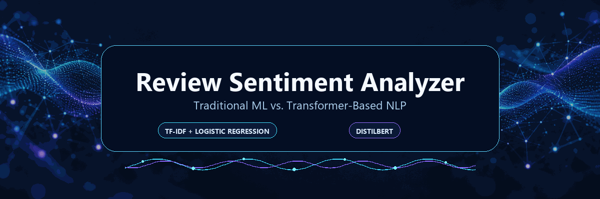
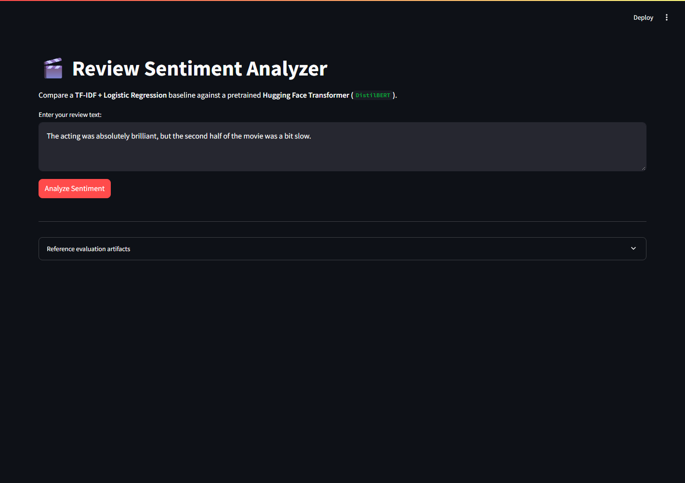
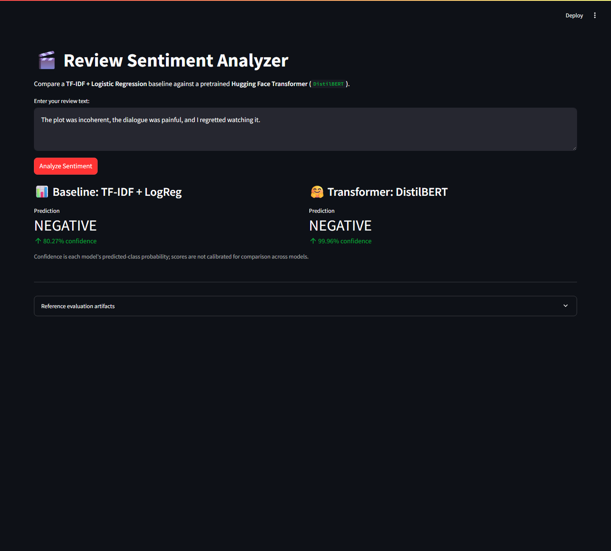
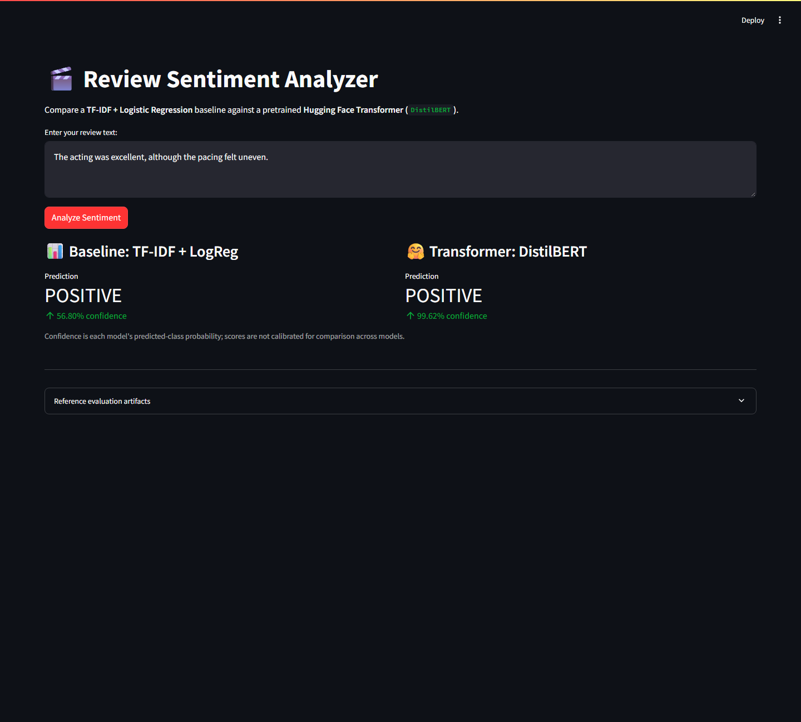
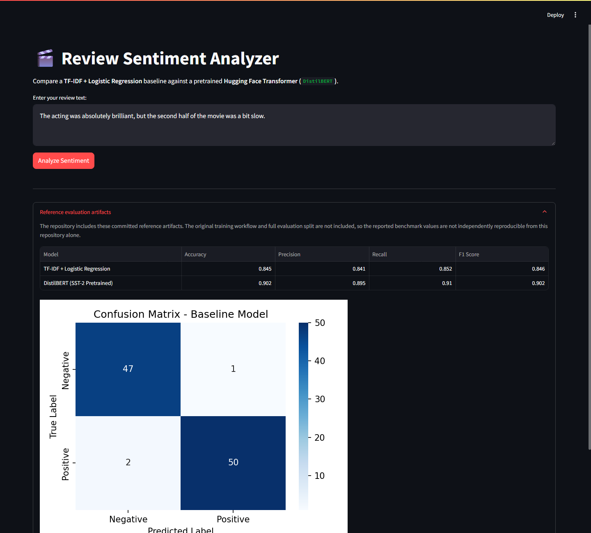
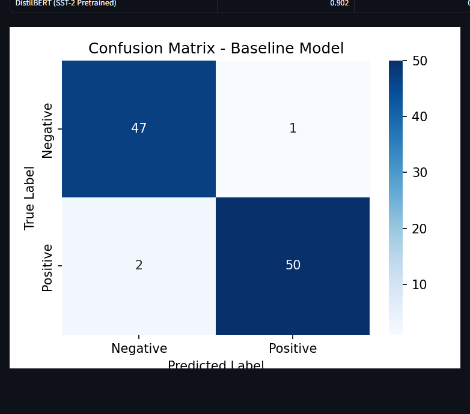
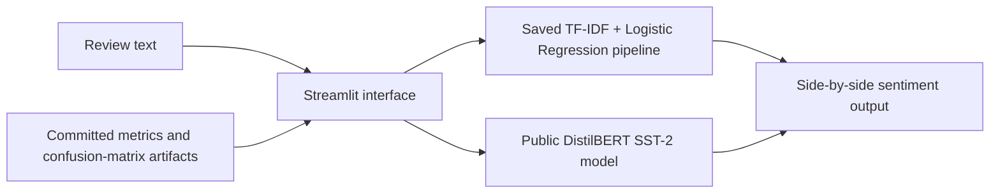

# Review Sentiment Analyzer



An interactive Streamlit app that compares the same review text with two sentiment classifiers: a persisted **TF-IDF + Logistic Regression** baseline and Hugging Face's pretrained **DistilBERT SST-2** model.

> Independent portfolio project. It is not affiliated with, endorsed by, or approved by Google or Hugging Face.

## Status

- **Local app:** validated with the pinned Python dependencies on Python 3.11.
- **Deployment:** not yet published. A Streamlit Community Cloud owner login is required before a live URL can be verified.
- **Demo video:** not yet recorded. The recording plan below is intentionally included instead of linking to fabricated footage.

## Screenshots

These are genuine captures from the locally running Streamlit application.

| Home | Positive prediction |
| --- | --- |
|  |  |

| Negative prediction | Nuanced model comparison |
| --- | --- |
|  |  |

| Reference metrics and baseline confusion matrix |
| --- |
|  |

<details>
<summary>Focused confusion-matrix capture</summary>


</details>

## Why this project

Sentiment models are frequently compared in notebooks but rarely made easy to inspect interactively. This project packages a compact classical baseline and a pretrained transformer behind one small interface so that a reviewer can submit the same text to both and inspect their outputs side by side.

## Features

- One-click, side-by-side inference for a persisted classical model and a public transformer.
- Saved baseline artifact; the application never retrains a model on startup.
- Clear validation for blank input and user-facing errors for model/download failures.
- Rooted artifact paths so the app works when launched from the repository root or another working directory.
- Optional reference metrics and a confusion-matrix artifact displayed only when their files are present.
- Pinned runtime dependencies to match the saved scikit-learn artifact.

## System workflow



## Models

| Model | Implementation | What the app uses |
| --- | --- | --- |
| Baseline | `TfidfVectorizer(max_features=5000, stop_words="english")` + `LogisticRegression(max_iter=1000)` | The committed `models/tfidf_logreg.pkl` pipeline. |
| Transformer | `AutoTokenizer` + `AutoModelForSequenceClassification` using `distilbert/distilbert-base-uncased-finetuned-sst-2-english` | Direct PyTorch inference avoids importing Transformers' broader `pipeline` helper. The first run downloads and caches the model. |

The two confidence values are each model's predicted-class probability. They are useful within a model but are **not calibrated for direct comparison** between model families.

## Data and evaluation artifacts

`data/sample_test_reviews.csv` contains 100 labelled review texts (52 positive and 48 negative) for smoke testing. Its upstream provenance and the full training/evaluation split are not included in this repository.

The committed `data/evaluation_metrics.csv` reports the following reference values:

| Model | Accuracy | Precision | Recall | F1 |
| --- | ---: | ---: | ---: | ---: |
| TF-IDF + Logistic Regression | 84.50% | 84.10% | 85.20% | 84.60% |
| DistilBERT (SST-2 pretrained) | 90.20% | 89.50% | 91.00% | 90.20% |

These values are displayed as **committed reference artifacts**, not as a reproducible benchmark: the original training workflow, evaluation script, and full held-out split are absent. The included confusion-matrix image is for the baseline model and corresponds to the included 100-review sample, so it should not be treated as a paired DistilBERT comparison.

As a local smoke check, the committed baseline pipeline was rerun against the included 100-row sample and produced accuracy **97.00%**, precision **98.04%**, recall **96.15%**, F1 **97.09%**, and confusion matrix `[[47, 1], [2, 50]]`. This verifies the shipped baseline artifact and explains the included confusion matrix; it is not a substitute for a controlled, paired model benchmark.

## Local setup

The saved scikit-learn pipeline was serialized with version `1.6.1`; use the pinned requirements and Python 3.11 for the most reproducible local run.

```powershell
git clone https://github.com/Avani376/sentiment-analysis-github.git
cd sentiment-analysis-github
py -3.11 -m venv .venv
.\.venv\Scripts\Activate.ps1
python -m pip install --upgrade pip
python -m pip install -r requirements.txt
streamlit run app/app.py
```

Then open `http://localhost:8501`. The first transformer load may take time because the public model must be downloaded. No API key or Hugging Face token is required for the public model in the default configuration.

## Streamlit Community Cloud deployment

No hosted URL is listed until it has been opened and tested. To publish this exact app:

1. Sign in to [Streamlit Community Cloud](https://share.streamlit.io/) with an account that has admin access to this repository.
2. Create an app from `Avani376/sentiment-analysis-github`, branch `main`, entry point `app/app.py`.
3. In **Advanced settings**, select Python 3.11. No secrets are required for the public DistilBERT model.
4. Watch the build logs, then test positive and negative inputs from a fresh browser session.
5. Add the verified `streamlit.app` URL here only after those checks pass.

## Demo recording plan

Record only after the deployed app has been verified. Keep the video to 60–90 seconds:

1. Open the deployed **Review Sentiment Analyzer** landing view.
2. Enter a clearly positive review and run the real analysis.
3. Replace it with a clearly negative review and run the real analysis.
4. Point out the two returned model predictions and the confidence-calibration caveat.
5. Expand the reference-artifacts section to show the committed metrics and baseline confusion matrix.
6. End on the repository URL and the verified deployment URL.

Use a clean browser profile with no unrelated tabs or personal information visible. Save the final recording as `assets/demo.mp4` only if it is reasonably sized for GitHub; otherwise publish it through a verified video host or GitHub Release and link it here.

## Repository layout

```text
.
├── app/
│   └── app.py                         # Streamlit entry point
├── assets/
│   ├── review-sentiment-banner.gif    # Lightweight animated README banner
│   ├── app-home.png                   # Genuine local app capture
│   ├── positive-prediction.png        # Genuine local app capture
│   ├── negative-prediction.png        # Genuine local app capture
│   ├── model-comparison.png            # Genuine local app capture
│   ├── benchmark-metrics.png          # Genuine local app capture
│   └── benchmark-confusion-matrix.png # Genuine local app capture
├── data/
│   ├── evaluation_metrics.csv          # Committed reference metrics
│   └── sample_test_reviews.csv         # 100 labelled smoke-test reviews
├── models/
│   └── tfidf_logreg.pkl                # Persisted baseline pipeline
├── notebooks/
│   └── experiment.ipynb                # Minimal historical experiment notebook
├── requirements.txt                    # Pinned runtime dependencies
└── README.md
```

## Limitations and next steps

- The source training pipeline and evaluation split are not versioned, so the reported two-model metrics cannot yet be independently reproduced.
- The notebook is a minimal historical artifact rather than a runnable training/evaluation workflow.
- Transformer startup depends on downloading a public model on first use and may be slower on constrained hosting plans.
- Confidence scores are not calibrated across the two model families.

Useful next improvements are to add a versioned training/evaluation script with fixed data splits, record dataset provenance and model metadata, add automated tests/CI, and publish a verified deployment plus real demo video.

## Contributing

Contributions are welcome through focused issues or pull requests. Please preserve the two-model comparison, keep credentials out of the repository, and include reproducible evidence for any reported metric or deployment claim.
